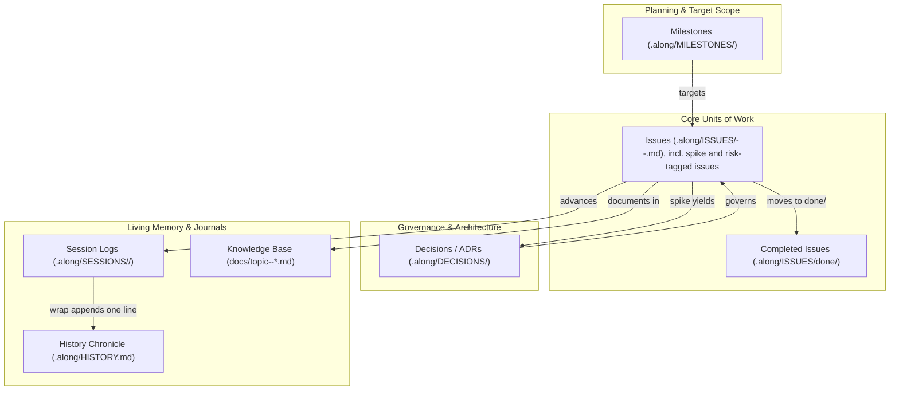

# Domain Model & Entity Ecosystem

Along models repository memory, project tracking, and documentation as a strongly-typed, schema-validated **Directed Acyclic Graph (DAG)** of Markdown entities with YAML front-matter (`protocol: along`).

---

## 1. Entity Ecosystem Architecture

The entity ecosystem provides a structured data layer that is simultaneously human-readable in plain Markdown, machine-parsable by local scripts and dashboards, and token-efficient for AI agents:



---

## 2. Granular Entity Taxonomy & Schemas

Along defines 6 entity types, each fulfilling a specific role in repository memory and lifecycle management. Risks, spikes and checklists are no longer separate entities: a risk or blocker is an issue tagged `risk`, a spike is a `spike` issue, and the completion checklist lives in `AGENTS.md` and is printed by `along wrap` ([debt--entity-model-slimming]; `along update` converts old `RISKS/`, `SPIKES/` and `CHECKLISTS/` folders through migration Step 16, see [Migrations](./topic--migrations.md)).

### 1. Issues (`.along/ISSUES/<type>--<slug>.md`)
Atomic units of engineering work. Along categorizes issues into **6 types**:

| Issue Type | Purpose & Scope | Example Slug |
| :--- | :--- | :--- |
| **`feat`** | New functional capabilities, user-facing features, API endpoints, or skills. | `feat--jwt-token-refresh` |
| **`bug`** | Defect repairs, regression fixes, edge-case remediation, or error recovery. | `bug--windows-path-escaping` |
| **`debt`** | Technical debt payoff, code refactoring, performance optimization, or dead code elimination. | `debt--dynstruct-migration` |
| **`task`** | Routine chores, infrastructure setup, CI/CD configuration, or dependency updates. | `task--setup-vitest-runner` |
| **`docs`** | Knowledge base authoring, architectural specifications, or developer workflow guides. | `docs--skills-architecture-overhaul` |
| **`spike`** | Timeboxed experiment, benchmark or library evaluation before an architectural commitment. Carries an `## Outcome` section; a concluded spike is closed as `done` and its result usually becomes an ADR (`related:`). | `spike--duckdb-vs-sqlite` |

A **risk or blocker** (rate limit, external dependency, upstream defect) is an ordinary issue, usually `debt`, tagged `risk`, with a `## Mitigation` section; the issue it blocks lists it in `blocked_by`.

#### YAML Front-Matter Schema:
```yaml
---
protocol: along
protocol_version: "3.9.4"
slug: jwt-token-refresh
type: feat
status: in-progress
priority: high
created: 2026-09-01
updated: 2026-09-01
completed: null
agent: antigravity
tags: [auth, security, tokens]
milestone: v2.3.0-security
blocked_by: [feat--db-schema-migrations]
related: [debt--token-revocation-latency]
parent: feat--identity-platform
superseded_by: null
duplicate_of: null
plan_status: approved           # optional: needs-approval | approved | needs-rework
---

# Issue Title

Detailed problem statement, constraints, and verifiable acceptance criteria.

## Acceptance Criteria
- [ ] Implement refresh token rotation endpoint.
- [ ] Add 100% test coverage for expired tokens.
- [ ] Update docs/topic--architecture.md.
```

#### Lifecycle States:
- **`open`**: Backlog item, not currently being executed.
- **`in-progress`**: Actively being developed by an agent or human. Initiated atomically via `along start <slug> [--worktree]`. Non-trivial code edits require an active issue.
- **`blocked`**: Waiting on an external dependency (`blocked_by`), API key, or a `risk`-tagged issue.
- **`done`**: Delivered terminal state. Fully implemented, verified by tests and code review. Closed via `along issue done <slug>` or `/along-wrap`. Mandatory field `completed: YYYY-MM-DD` is set, and the file is moved to `.along/ISSUES/done/<type>--<slug>.md`. Only `done` issues count towards milestone and sprint completion metrics.
- **`superseded`**: Non-delivered terminal state. Replaced by another issue or architectural decision. Closed via `along issue supersede <old-key> --by <new-key>` (rewrites inbound references) or `along issue done <slug> --status superseded --superseded-by <slug>`. Mandatory field `completed: YYYY-MM-DD` is set, `superseded_by: <target-slug>` references the replacement entity, and the file is moved to `.along/ISSUES/done/`.
- **`cancelled`**: Non-delivered terminal state. Abandoned or intentionally dropped requirements. Closed via `along issue done <slug> --status cancelled`. Mandatory field `completed: YYYY-MM-DD` is set, and the file is moved to `.along/ISSUES/done/`.
- **`duplicate`**: Non-delivered terminal state. Redundant issue covered by another entity. Closed via `along issue done <slug> --status duplicate --duplicate-of <slug>`. Mandatory field `completed: YYYY-MM-DD` is set, `duplicate_of: <primary-slug>` references the primary entity, and the file is moved to `.along/ISSUES/done/`.

#### Issue Plan (`.along/ISSUES/<type>--<slug>/plan.md`):
The ticket says what and why; the plan says how. An issue's plan lives in the folder named after its ticket, is committed with it, and moves with it (`along wrap`, `along issue done`, `reopen`, `rename`, `supersede`; `delete` removes it). It is one living file: the approved baseline as `## Revision 1`, then each correction made during the work as the next revision with a `Reason:` line, and `## Rework requested` notes. Session blackboards and `along-team` read and write this file (`session.plan_path`); a blackboard without an issue keeps its own `plan.md`.

`plan_status` in the ticket front-matter records where the plan stands:
- **`needs-approval`**: written, waiting for the user's yes (set by the agent).
- **`approved`**: ready to run. Set only by `along plan approve` after the user's explicit yes, which also appends an approval event to the machine-local `.along/.session/plan-approvals.jsonl`. `along start` and the orchestrator trust `approved` only with such an event on this machine; otherwise they ask the user again. File-tool edits that set `approved` are denied by `require-plan-approval`.
- **`needs-rework`**: the plan cannot be followed within the ticket (`along plan rework <slug> --reason "..."`); the user decides how to proceed.
- absent: no plan yet.

The board (`.along/ISSUES.md`) shows `plan ready`, `plan: needs approval` or `plan: needs rework` after the entry. See `docs/topic--along-protocol.md` "Issue Plans & Approving Ahead" for the flow.

#### Quality Gates & Anti-Stub Validation (`validate_issue_completion`):
To prevent empty scaffolding or hallucinated completions from degrading project memory:
- **Mandatory Sections**: Every issue must declare `## Problem`, `## Requirements`, and `## Acceptance Criteria`.
- **Anti-Stub Invariance**: Issues containing template placeholder text (such as `"Describe the feature..."` or `"Task requirement 1"`) or lacking concrete criteria are blocked by `along start` and `along plan approve`.
- **Completion Validation**: Transitioning an issue to `done` (`along wrap` or `along issue done <slug>`) executes `validate_issue_completion`:
  - Refuses issues with unfilled scaffold placeholders;
  - Requires mandatory `## Acceptance Criteria` with at least one completed checklist item (`- [x]`);
  - Requires all checklist items to be checked (`- [x]`); any remaining `- [ ]` checklist item aborts wrap unless explicitly overridden with `--force-reason`.
- **Audit Tooling**: Run `along doctor issues` (or `along doctor --issues`) to audit all `.along/ISSUES/` files for template stubs or uncompleted criteria.

---

### 2. Architectural Decision Records (ADRs) (`.along/DECISIONS/` & Projections)
Dual-layer architecture: modular records in `.along/DECISIONS/ADR-YYYY-MM-DD--<slug>.md` paired with compiled `.along/DECISIONS.md` (compact summary board) and `.along/CONSTRAINTS.md` (active constraints) projections, alongside `docs/decisions/` for MkDocs search and publishing.

#### Why Modular File-Per-ADR with Compiled Projections?
- **Bounded Session-Start Context**: Agents read only active architectural rules in `.along/CONSTRAINTS.md` at session start, keeping session-start reads bounded.
- **Git Branch Isolation**: Storing ADRs in distinct files (`.along/DECISIONS/ADR-YYYY-MM-DD--<slug>.md`) eliminates git merge collisions entirely.
- **Search & MkDocs Integration**: Each ADR is published to `docs/decisions/`, making decisions fully searchable in the static documentation site.
- **Legacy Compatibility**: Repositories using single-file append-only `DECISIONS.md` continue to work seamlessly.

#### Schema & Entry Format:
```markdown
---
title: "Session-Scoped Blackboard Memory"
date: 2026-08-31
status: accepted # or: superseded
superseded_by: <target-slug> # optional
type: decision
slug: session-scoped-blackboard-memory
tags:
  - architecture
  - memory
---

# ADR-2026-08-31--session-scoped-blackboard-memory - Session-Scoped Blackboard Memory

- Date: 2026-08-31
- Status: accepted (or: superseded by ADR-YYYY-MM-DD--<slug>)
- Context: In-flight multi-agent coordination data cluttered conversation context.
- Decision: Introduce .along/.session/<slug>/ with automated GC during /along-wrap.
- Consequences: Eliminates state leakage; guarantees clean repository hygiene.
```

---

### 3. Milestones & Sprints (`.along/MILESTONES/<slug>.md`)
Group multiple issues into structured release targets, sprints, or major project stages.

#### Schema:
```yaml
---
protocol: along
protocol_version: "3.9.4"
slug: v2.3.0-security
title: Security & Authentication Hardening
status: in-progress
due_date: 2026-09-15
created: 2026-09-01
target_issues:
  - feat--jwt-token-refresh
  - bug--auth-header-leak
  - debt--crypto-upgrade
progress_pct: 33
---
```

#### Milestone Synchronization & Progress Engine
Milestones and issues maintain a **bidirectional relationship** orchestrated by `along milestone sync` and `along issue update`:
- **Bidirectional Linkage**:
  - Issues declare their assigned milestone via frontmatter `milestone: <slug>`.
  - Milestones declare their target issues via frontmatter `target_issues: [<type>--<slug>, ...]`.
- **Dynamic Discovery**:
  Running `along milestone sync [<slug>]` scans all issues across `.along/ISSUES/` and `.along/ISSUES/done/`. Any issue declaring `milestone: <slug>` is dynamically aggregated into `target_issues` (sorted alphabetically by canonical key).
- **Progress Calculation**:
  Progress percentage is automatically computed based on terminal issue states:
  $$\text{progress\_pct} = \operatorname{round}\left(\frac{\text{done\_count}}{\text{total\_target\_issues}} \times 100\right)$$
  Where `done_count` includes all issues in `.along/ISSUES/done/` or having a terminal status (`done`, `superseded`, `cancelled`, `duplicate`). If `total_target_issues` is 0, `progress_pct` evaluates to 100 if the milestone is already completed, else 0.
- **Automated Status State Machine**:
  - `total > 0` and `done_count == total`: Milestone status transitions to `completed`.
  - `total > 0` and (`in_progress_count > 0` or `done_count > 0`) with `done_count < total`: Milestone status transitions to `in-progress`.
  - `total > 0` and `done_count == 0` and `in_progress_count == 0`: Milestone status transitions to `open`.
- **Fuzzy Milestone Resolution**:
  Commands accepting milestone identifiers (`along milestone show`, `along issue update --milestone`) support 3 levels of query matching:
  1. *Exact Match*: Exact slug or filename stem (e.g. `v4.0.0-runtime-gates-and-worktree-isolation`).
  2. *Version Prefix Match*: Version query with or without leading `v` (e.g. `4.0`, `v4.0`, `4.0.0` resolve to `v4.0.0-runtime-gates-and-worktree-isolation`).
  3. *Substring Match*: Unambiguous substring in slug or title (e.g. `runtime-gates`).

---

### 4. Work Sessions (`.along/SESSIONS/<YYYY>/<YYYY-MM-DD>--<slug>.md`)
Chronological work journal written by `along wrap` (and `along issue done`, `along scratch purge`, `along session gc`) before the session blackboard is deleted. A log does not repeat git or the plan: it keeps the front matter, the summary, the decisions, and the blackboard record (step table, research, execution trace, notes, reviews). The paths attributed to the issue are kept as the `files:` front matter, which `along session close`, `along start` and `along doctor` read to find uncommitted work of wrapped issues (logs written before v4.6.0 carry an `### Attributed Files` table instead, still read).

#### Schema:
```yaml
---
protocol: along
date: 2026-09-01
slug: skills-architecture-overhaul
agent: antigravity
branch: main
commit: a1b2c3d
summary: Complete overhaul of docs/ Knowledge Base and full 18-skill reference.
milestone: v2.2.0-along
issues_advanced: []
issues_completed:
  - docs--comprehensive-knowledge-base-and-skills-architecture
decisions: []
files:
  - docs/topic--skills-reference.md
  - skills/along-wrap/SKILL.md
---
```

---

### 5. Project History Chronicle (`.along/HISTORY.md`)
Single-line append-only chronological log, one line per slug, written by `along wrap` (and `along history append` / `along session create`, which go through the same writer). It is the one-line record of a completion; the issue body stays in `ISSUES/done/` and the details in the session log:
```markdown
# History

2026-09-01 - skills-architecture-overhaul - antigravity - Rebuild Knowledge Base and 18-skill reference - [Session Log](./SESSIONS/2026/2026-09-01--skills-architecture-overhaul.md)
```

---

### 6. Knowledge Base (`docs/topic--*.md`, `docs/INDEX.md`)
Curated, cross-linked LLM-Wiki articles maintaining domain architecture, API contracts, dependencies, and developer guides.

`.along/VISION.md` and `.along/GLOSSARY.md` complete the context: the repository root gets them on `along init`; a nested context (subproject) creates them on first use.

---

### 7. Cross-Runtime Session Entities (`.along/.session/<slug>/`)
Ephemeral coordination bus enabling disparate vendor runtimes (Claude Code, OpenAI Codex, OpenCode, Antigravity) to execute multi-step workflows without shared memory:

#### 1. Run Records (`.along/.session/<slug>/runs/<run-id>.json`)
Tracks individual agent runtime executions within an issue session:
```json
{
  "run_id": "run-20261023T014500Z-abcd",
  "role": "implementer",
  "runtime": "claude-code",
  "model": "claude-3-7-sonnet",
  "step": 1,
  "start": "2026-10-23T01:45:00Z",
  "end": "2026-10-23T01:48:30Z",
  "exit_code": 0,
  "outcome": "done",
  "changed_files": ["scripts/alongkit/handoff.py"],
  "usage": { "input_tokens": 12000, "output_tokens": 1500 },
  "handoff_note": "handoff.md"
}
```
- **Outcomes**: `done`, `fail`, `needs-input`, `timeout`, `in-progress`.
- **Usage**: Serves as single source of truth for operator cards and observability.

#### 2. Machine-Readable Review Verdicts (`reviews/step-N.md`)
Enforces automated gate evaluation via YAML front-matter without brittle prose parsing:
```yaml
---
verdict: fail
defects:
  - severity: blocking
    description: "Missing collision prevention check when acquiring live claim"
    file: "scripts/alongkit/handoff.py"
    line: 215
---

# Step 1 Code Review
Detailed reviewer critique and evaluation against acceptance criteria.
```
- **Severities**: `blocking` (must fix, fails verdict), `important` (should fix, fails verdict), `nit` (informational, passes verdict).
- **Invariance**: Verdict MUST be `fail` when blocking or important defects are present.

#### 3. Questions Entity (`.along/.session/<slug>/questions/<id>.md`)
Asynchronous operator clarification mechanism replacing interactive stdin bridges:
```yaml
---
id: q-1
status: answered
question: "Which database backend should be selected for session caching?"
options:
  - "In-memory dict"
  - "SQLite blackboard"
recommended: "In-memory dict"
answer: "In-memory dict"
answered_by: "operator"
created_at: "2026-10-23T01:40:00Z"
answered_at: "2026-10-23T01:42:00Z"
---

Additional context regarding throughput requirements.
```
- When an agent requires human decision, it writes a question, exits with outcome `needs-input`, and awaits operator resolution.

#### 4. Claim Management (`state.json` `claimed_by`)
Prevents concurrency collisions across autonomous runner daemons:
```json
{
  "claimed_by": {
    "run_id": "run-20261023T014500Z-abcd",
    "runtime": "antigravity",
    "claimed_at": "2026-10-23T01:45:00Z",
    "expires_at": "2026-10-23T02:15:00Z"
  }
}
```
- Active claims block secondary runs on the same issue.
- Expired claims (`now >= expires_at`) can be taken over automatically.

#### 5. Handoff Notes & Brief Engine (`handoff.md` & `along brief`)
- **Handoff Note** (`handoff.md`): Compact note (under 25 lines) written at run completion detailing what was done, what remains, and traps.
- **Brief Engine** (`along brief <slug> --role <role>`): Compiles deterministic, compact, size-bounded prompt payload containing issue goal, `REQ-N`, criteria, step plan, constraints, open defects, answered questions, handoff note, git diff stat, and review policies.

---

## 3. Graph Invariance & Canonical Slug Linking

To prevent link breakage and dependency graph drift, Along enforces **Canonical Slug Invariance**:

1. **Canonical Key References**:
   - Entities reference other entities strictly by their canonical key (`<type>--<slug>` or `<slug>`), **NEVER** by filesystem paths (`.along/ISSUES/open/...`).
   - *Example*: `blocked_by: [feat--db-schema]` remains 100% valid when the target file moves from `.along/ISSUES/feat--db-schema.md` to `.along/ISSUES/done/feat--db-schema.md`.
2. **Unidirectional Graph Storage**:
   - In YAML front-matter, relationships are stored unidirectionally (`blocked_by: []`, `related: []`, `parent: <slug>`).
   - Reciprocal relationships (`blocks`, `children`) and full DAG topologies are computed dynamically by graph parsers and the Along dashboard engine, eliminating LLM synchronization drift.
3. **Cross-Context Resolution**:
   - Reference fields (`parent`, `blocked_by`, `related`, `superseded_by`, `duplicate_of`) resolve along the chain of enclosing `.along/` contexts up to the outermost one below home, crossing nested `.git` / submodule boundaries (`repo.context_chain`, `entities.ancestor_contexts`); each context is searched in `ISSUES/` and `ISSUES/done/`. A child issue in a submodule can therefore name the workspace umbrella above it.
   - A `parent` equal to the issue's own key (a child sharing the umbrella's key) resolves only in enclosing contexts; otherwise it is the error `invalid self-parent reference`.
   - The qualifier `root:<key>` (e.g. `parent: root:feat--identity-platform`) resolves only in the outermost context.
   - `along issue sync` prints `<key>: parent <parent> (found in <ctx>)` for each cross-context parent; commit-time snapshot checks add the working-tree keys of contexts above the git top; the dashboard graph shows an external parent as a node with status `external`.

---

## 4. Automated Intent Recognition Heuristics

To ensure zero administrative overhead for developers, Along host agents automatically infer project tracking actions from natural language prompts:

| Natural User Prompt / Trigger | Inferred Entity | Automatic Background Agent Action |
| :--- | :--- | :--- |
| *"Build feature X"*, *"Add endpoint Y"* | **`feat ISSUE`** | Auto-creates `.along/ISSUES/feat--<slug>.md` with `status: in-progress`. Updates `ISSUES.md`. |
| *"Fix bug X"*, *"Fix crash on Y"* | **`bug ISSUE`** | Auto-creates `.along/ISSUES/bug--<slug>.md` with `priority: high`. |
| *"Refactor module X"*, *"Clean up Y"* | **`debt ISSUE`** | Auto-creates `.along/ISSUES/debt--<slug>.md`. |
| *"Update documentation for X"* | **`docs ISSUE`** | Auto-creates `.along/ISSUES/docs--<slug>.md`. |
| *"Rate limit hit"*, *"Blocked on API key"* | **`risk`-tagged ISSUE** | Auto-creates `.along/ISSUES/debt--<slug>.md` tagged `risk` with a `## Mitigation` section; the blocked issue gets `status: blocked` and `blocked_by: [debt--<slug>]`. |
| *"Benchmark X vs Y"*, *"Test if Z works"* | **`spike ISSUE`** | Auto-creates `.along/ISSUES/spike--<slug>.md` (`along issue create spike <slug>`); records the `## Outcome` and the resulting ADR before it is wrapped. |
| *"Target for next sprint"*, *"Release v2.0"* | **`MILESTONE`** | Auto-creates `.along/MILESTONES/<slug>.md`; binds target issues. |
| *"I'm done for today"*, *"Wrap up"* | **`SESSION & WRAP`** | Executes `/along-wrap`: verifies tests, records session log, moves completed issues to `done/`, updates `HISTORY.md`. |
