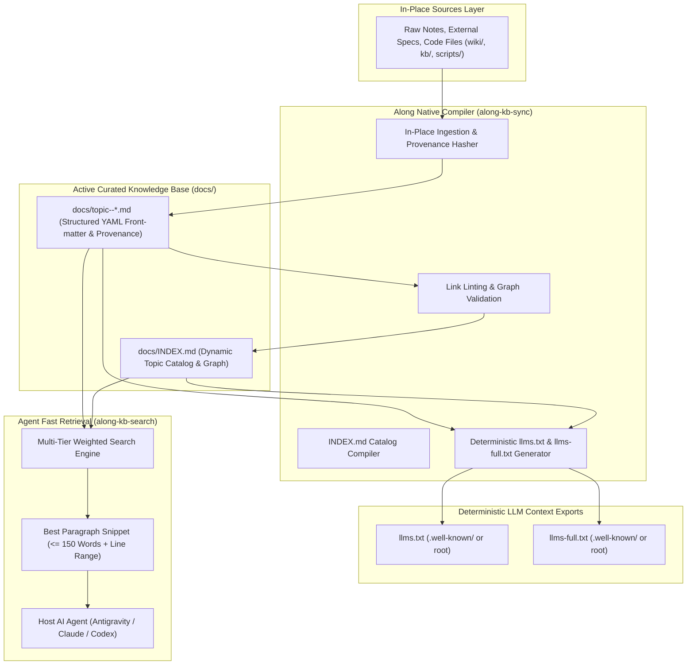

# Topic-Based Knowledge Base Architecture & Paradigm

Along implements a **Deterministic Topic-Based Knowledge Architecture**, combining industrial technical communication standards (**IBM DITA**, **Canonical Diataxis**), classical Information Retrieval (**TF-IDF**), and repository-native AI navigation into a single, unified source of truth for software engineering teams.

---

## 1. Why Topic-Based Architecture? (Industrial Reality vs Naive LLM-Wiki)

While Andrej Karpathy popularized the concept of an "LLM-Wiki" for digesting unstructured personal media (papers, podcasts, raw personal notes), directly transplanting that model into software engineering creates severe operational failure modes:

### The Three Failure Modes of Naive LLM-Wiki in Codebases
1. **Stochastic Git Jitter & Broken Code Review**:
   - If documentation is treated as a secondary byproduct periodically recompiled by an LLM, every sync floods Git history with non-deterministic phrasing rewrites and synthetic churn.
   - Pull requests become unreviewable, Git diffs are polluted with noise, and hallucinations silently overwrite verified technical contracts.
2. **The Split-Brain Trap (Two Conflicting Sources of Truth)**:
   - If developers write unstructured "raw notes" while a machine compiles a "secondary wiki", the team maintains two competing realities.
   - If a developer updates a raw note, the wiki is immediately stale. If an agent or engineer updates the wiki, the raw note is stale or direct edits are wiped out on the next rebuild.
3. **Chronic Merge Conflict Hell**:
   - Unstructured or monolithic documentation files guarantee Git merge collisions whenever multiple developers or parallel agents work on different features concurrently.

### The Dual Problem: Prompt Stuffing vs Opaque Vector DBs
AI coding agents face two equally flawed extremes:
- **Context Bloat & Prompt Saturation (Prompt Stuffing)**: Loading multi-kilobyte documentation into agent prompts consumes 10,000 to 30,000+ tokens per interaction, exhausting the context window and degrading model reasoning.
- **Opaque & Fragile External Vector DBs**: Vector databases slice code across arbitrary token boundaries, blur exact symbols into fuzzy semantic vectors, fail during branch switching, and introduce complex native C++ dependencies.

For an exhaustive architectural comparison against vector DBs, passive conversational scrapers (jevmem, Laya), and prompt stuffing, see [System Comparisons & Alternative Memory Architectures](./topic--system-comparisons.md).

### The Solution: Deterministic Topic-Based Architecture
Along synthesizes 25 years of industrial technical writing and 50 years of information retrieval into a production-grade system:
- **Modular Topic Files (`docs/topic--*.md`)**: Single, human-readable source of truth in Git, organized by domain.
- **Zero-Manual-Merge Indexing (`docs/INDEX.md`)**: Catalog and navigation compiled 100% deterministically by lightweight Python scripts without LLM hallucinations.
- **In-Memory Lexical Retrieval (`along-kb-search`)**: Pure standard-library TF-IDF engine returning the single best-matching paragraph (<= 150 words) with its section heading and exact line range, instead of whole files.

---

## 2. Topic-Based Architecture & Data Flow



---

## 3. Fast Retrieval Mechanics & 50-Year IR Foundations (TF-IDF & Karen Sparck Jones)

Instead of deploying opaque, heavy vector databases or dumping whole articles into prompts, Along grounds its retrieval engine in 50 years of classical Computer Science and Information Retrieval (IR):

### The Classical Lineage of Lexical Retrieval
- **Hans Peter Luhn (IBM, 1957)**: Introduced Term Frequency (TF), measuring the prominence of terms within a passage.
- **Karen Sparck Jones (1972)**: Established Inverse Document Frequency (IDF) in her foundational paper, proving that rare terms across a corpus carry exponentially higher discriminative value.
- **Gerard Salton (Cornell, 1975)**: Unified these concepts into the classic TF-IDF vector space model, powering Lucene, Elasticsearch, and global enterprise search.

### Why Classical TF-IDF Outperforms Vector Databases in Codebases
1. **Exact Code Symbol Precision**:
   - Vector embeddings project distinct identifiers (`user_id`, `user_uuid`, `get_user_account`) into nearby fuzzy clusters, causing ambiguity during code refactoring.
   - TF-IDF enforces exact token and quoted phrase matching, ensuring agents locate the precise function, flag, or configuration key without semantic drift.
2. **Zero Native Dependencies, No Index to Rebuild**:
   - Pure Python standard library implementation: no embeddings, no database, no native builds (no `onnxruntime` or `hnswlib` compilation failures on developer machines).
   - The corpus is read from the working tree on every call, so a branch switch never leaves a stale index behind.
3. **Bounded Snippets**:
   - Search returns one paragraph per hit (<= 150 words) with its section heading and an exact file path and line range (`docs/topic--cli-reference.md#L589-L605`), feeding the [Progressive Disclosure Ladder](#5-progressive-disclosure-ladder).

### Corpus & Query Semantics
- **Corpus**: `docs/` topics, `.along/PROTOCOL.md`, and living memory (issues, ADRs, milestones, sessions); `--category` narrows it. Archived entities (done issues, session logs, superseded ADRs) are excluded unless `-a` / `--archive` is passed. Results default to the top 8 (`--limit`).
- **Tokens**: lowercase word tokens (`[\w\-]+`), so hyphenated and underscored identifiers such as `kb-sync` or slugs stay one token and match only as a whole (or by prefix with `--prefix`).
- **Stemming**: `light_stem` strips English suffixes (`-s`, `-es`, `-ies`, `-ing`, `-ed`). Non-English text is matched by exact tokens only.
- **AND by default**: every query term and quoted phrase must match somewhere in the entry. `--any` switches to OR; `--prefix` lets terms match token prefixes.
- **Quoted phrases**: `"bounded context budget"` must appear as an exact adjacent sequence.
- **Literal mode** (`--literal`): a raw substring match with its own fixed scoring (see below).

### IDF Formula
`compute_idf` counts document frequency over title, slug, tags and body (stems are counted too) and applies smoothed IDF:

```text
IDF(term) = ln((N + 1) / (df + 1)) + 1
```

A term found in 1-2 topics out of hundreds scores several times higher than a term found everywhere. That is why one-topic-per-file matters (see [Authoring Topics for Retrieval](#4-authoring-topics-for-retrieval)).

### Ranking Weights
`search_knowledge_base` adds up the following per entry. Each term scores at most one tier per field (exact > stem > prefix).

| Match Scope | Exact | Stem | Prefix (`--prefix`) | Rationale |
| :--- | :--- | :--- | :--- | :--- |
| **Title** | **+15 x IDF** | +7.5 x IDF | +6 x IDF | Direct match on the article subject. |
| **Slug** | **+12 x IDF** | +6 x IDF | +5 x IDF | Stable architectural identifier. |
| **Tags** | **+10 x IDF** | - | - | Curated keywords; whole-tag exact match only. |
| **Body** | **min(TF x IDF, 25)** | stems add to TF | prefix TF if no exact hit | Frequency is capped so long articles cannot drown short precise ones. |
| **Quoted Phrase** | +30 title / +20 slug / min(15 x count, 30) body | - | - | Exact adjacent sequence. |

| Entry Adjustment | Weight | Rationale |
| :--- | :--- | :--- |
| **Curated docs boost** | **+20** | `docs/topic--*.md` and `.along/PROTOCOL.md` outrank issues and sessions that merely mention the same words. |
| **Active status** | +2 | Open, in-progress, active or accepted entities. |
| **Archived** | -10 | Only when archived entities are included. |

**Literal mode** scores differently: base 100, +50 slug substring, +30 title substring, min(10 x count, 30) body, +20 curated docs, -10 archived.

### Snippet Extraction
`extract_passage_location_and_snippet` splits the matched file into blocks. A block is a paragraph separated by blank lines or headings. Front-matter is skipped and a fenced code block stays whole. Each block is scored (+15 per phrase, +6 per exact term, +3 per stem match); the best block is returned with:
- its enclosing heading (`section`),
- its 1-indexed line range (`file#Lstart-Lend`),
- its text, flattened and capped at **150 words**.

### Measured Performance
`scripts/bench_kb_search.py` measures both the real repository and a synthetic 1,000-entity fixture. Sample run on this repository (Windows, Python 3.12, 2026-11-13):

| Corpus | Load | Query p50 | Query p95 | Snippet vs matched documents |
| :--- | :--- | :--- | :--- | :--- |
| This repository (837 entities, ~0.8M tokens) | ~0.8 s | ~245 ms | ~290 ms | 95-98% fewer tokens |
| Synthetic fixture (1,000 entities) | - | ~158 ms | ~168 ms | ~85% fewer tokens |

- The ADR-2026-09-09 gate is **p95 < 250 ms on the 1,000-entity fixture**.
- Measured against the whole corpus rather than the matched documents, savings exceed 99%. `--stats` prints live corpus size, returned tokens and the savings percentage for any query.

---

## 4. Authoring Topics for Retrieval

Search quality is a property of how topics are written. Every authoring rule below produces a concrete ranking or snippet signal in `along-kb-search`:

| Structure Rule | Search Signal It Produces |
| :--- | :--- |
| **One topic per file (DITA)** | Clean document boundaries. A domain term appears in few files, so its IDF is high and it points at the right topic instead of being diluted across mixed articles. |
| **Specific `title`** | Strongest field: +15 x IDF per exact term. Name the subject in words people search for. |
| **Descriptive `slug`** | +12 x IDF, but only when the query contains the whole slug: hyphens do not split tokens, so `llm-wiki-architecture` is one token (`--prefix` also matches its beginning). Put every searchable word in the title too. |
| **`tags` in front-matter** | +10 x IDF for synonyms and concepts the body may not spell out. Tags match whole: prefer single-word tags (`search`, `idf`) over long multi-word ones. |
| **`##` headings + short paragraphs** | The snippet is one paragraph. Short, single-idea paragraphs under a clear heading return a complete answer with its section and line range. |
| **Exact identifiers in backticks** | Lexical exact match on `kb-sync`, `compute_idf`, flag names. Hyphenated and underscored names are single tokens, so a query for `search` does not hit `kb-search`; spell the plain words out in prose as well. The AST grounding gate also checks identifiers against the code. |
| **English prose** | `light_stem` normalizes plural and tense forms only for English text. |
| **Topic lives in `docs/`** | +20 curated boost over issues and sessions mentioning the same terms. |

### Author Checklist
1. One subject per `docs/topic--<slug>.md`; split when a file starts answering two unrelated questions.
2. Title and slug use the words a reader would type.
3. Add 5-12 single-word tags, including synonyms absent from the body.
4. Keep paragraphs short and self-contained under `##` / `###` headings. A paragraph should make sense when returned alone.
5. Write identifiers exactly as in code, in backticks.
6. Check with `along kb-search "<query>" --stats` that the topic ranks first for its own subject.

---

## 5. Progressive Disclosure Ladder

Humans and agents read the knowledge base the same way. They descend one step at a time and stop as soon as they have enough:

```text
INDEX.md  ->  front-matter  ->  search snippet   ->  surrounding lines  ->  full file
(catalog)     (what it is)      (<= 150 words)       (20-30 lines)          (last resort)
```

1. **`docs/INDEX.md`** (or the compact `along kb-search --toc` catalog): compiled list of topics with titles and tags.
2. **Front-matter**: title, type, tags, provenance sources and write policy tell what a topic covers and how far to trust it.
3. **Snippet**: `along kb-search` returns the best paragraph with `file#Lstart-Lend`.
4. **Surrounding lines**: read 20-30 lines around that range when the paragraph needs context.
5. **Full file**: only when the task really concerns the whole topic.

---

## 6. In-Place Source Grounding, Provenance & Drift Gate

Along enforces in-place provenance for all synthesized Knowledge Base articles:

1. **In-Place Source Preservation**:
   - Raw sources, specifications, and reference notes remain in their original project locations (e.g. `wiki/`, `kb/`, `scripts/`). Files are NEVER moved into a hidden `.archive/` directory.
   - Every compiled article in `docs/topic--*.md` explicitly tracks its originating source files via the `sources: [{path, hash}]` YAML front-matter list.
2. **SHA-256 Drift Detection**:
   - The compiler computes normalized SHA-256 hashes of tracked sources during sync.
   - Running `python scripts/along_kb_sync.py --check` detects if underlying code or raw specifications have evolved, emitting `[DRIFT]` warnings that alert agents to review and reconcile documentation.
3. **Intent Gate for Content Reduction (`--prune-intent`)**:
   - To guard against accidental LLM deletions, `along-kb-sync` calculates net line-count reductions against Git `HEAD`.
   - In monorepos and nested subprojects, path queries use `HEAD:./<rel_path>` to ensure Git resolves paths relative to the subproject working directory rather than the repository root.
   - If an article shrinks by >25% in lines (and at least 10 lines), compilation halts with exit code 2 unless `--prune-intent [REASON]` is explicitly supplied.

---

## 7. Deterministic LLM Context Compilation: llms.txt & llms-full.txt

To provide external LLMs and IDE assistants with immediate context, `along-kb-sync` deterministically manages both index and full-context exports:

1. **Path Resolution & `.well-known/` Support**:
   - Resolves target files using `alongkit.repo.resolve_llm_targets(...)`.
   - Follows web standard precedence:
     - If `.well-known/llms.txt` exists, updates in `.well-known/`.
     - If root `llms.txt` exists, updates in root.
     - If both exist, synchronizes both to prevent drift.
     - If neither exists, creates in `.well-known/` if that directory exists, else defaults to repository root.
2. **Smart Non-Destructive `llms.txt`**:
   - Updates the `## Documentation Links` section to match active `docs/topic--*.md` articles.
   - Non-destructively preserves user-defined custom sections, descriptions, and external HTTP(S) references.
   - On initial creation, extracts project title and introductory summary from `README.md` (identifying the first H1 header and extracting the first valid blockquote or prose paragraph while ignoring GitHub alert callouts like `> [!NOTE]`, badges, and raw HTML).
3. **Pure Script Deterministic `llms-full.txt` Compilation**:
   - Zero LLM generation: compiled 100% deterministically by script.
   - Assembles `README.md`, `AGENTS.md`, and all `docs/topic--*.md` articles in sorted order.
   - Strips YAML front-matter and structures documents with clean Markdown section headers.
4. **Cascading Subproject Synchronization**:
   - Automatically walks downward to discover all subproject Along contexts and synchronizes their local `llms.txt` and `llms-full.txt` files whenever nested documentation exists.

---

## 8. Documentation Blast Radius & Code-Graph-to-Wiki Synchronization

In the LLM-Wiki paradigm, documentation is a living asset that evolves alongside code. Along enforces a **Deterministic 2-Phase Blast Radius Gate**:

```mermaid
flowchart LR
    DIFF["Code Modifications (git diff)"] --> CRG["along graph-impact (code-review-graph AST)"]
    CRG --> IMPACT["Impacted Symbols & Downstream Callers"]
    IMPACT --> SEARCH["along-kb-search (Topic Query)"]
    SEARCH --> TOPICS["Targeted docs/topic--*.md Files"]
    TOPICS --> EDIT["Factual Article Updates"]
    EDIT --> KBSYNC["along-kb-sync --strict (Integrity Gate)"]
    KBSYNC --> INDEX["docs/INDEX.md & Verified Links"]
```



1. **AST Blast Radius Discovery**: During task review, agents invoke `along graph-impact` (powered directly by `code-review-graph` CLI) to trace caller hierarchies, caller depth, and affected execution flows.
2. **Topic Mapping**: Agents query `along-kb-search` with the modified symbol names to pinpoint the exact `docs/topic--*.md` files documenting those interfaces.
3. **Factual Updating**: Agents update the affected topic articles with concrete code facts (zero placeholders).
4. **Compilation & Link Gate**: Running `python scripts/along_kb_sync.py --strict` validates relative links across the repository and recompiles `docs/INDEX.md`.

---

## 9. Deterministic Topic Dictionary, Auto-Crosslinking & AST Symbol Grounding

To guarantee factual precision and cross-reference coherence without human micro-management, Along equips `along-kb-sync` with three deterministic compiler mechanisms:

### Deterministic Topic Dictionary & Auto-Crosslinking
- **TopicDictionary Indexing**: The compiler automatically extracts title, slug, and tag permutations across all `docs/topic--*.md` files. Entries are sorted longest-first to prioritize specific domain aliases (e.g. `LLM-Wiki Architecture` before `Architecture`).
- **Bounded Cross-Link Replacement**:
  - `scan_crosslinks()` and `apply_crosslinks()` audit prose for unlinked concept opportunities.
  - Skips Markdown headings (`#`, `##`), fenced code blocks (` ``` `), inline code spans (`` `...` ``), and existing relative/absolute links.
  - Enforces the **First Occurrence Per Section Rule**: only the first unlinked mention within any H2 section (`## `) is converted to a link (`[Term](./topic--slug.md)`).
  - Self-linking to the current article is strictly excluded.
  - Idempotent: re-running `--crosslink-apply` yields zero modifications.
- **CLI Options**:
  - `along kb-sync --crosslink-check`: Audits documentation for unlinked topic opportunities without modifying files.
  - `along kb-sync --crosslink-apply`: Applies deterministic cross-links in-place.

### AST Code Symbol Grounding Gate
- **AST Symbol Extraction**: Parses Python source files across `scripts/`, `dashboard/`, `tests/`, and `.along/scripts/` using Python's native `ast` module. Discovers classes, functions, async functions, methods, and uppercase module-level constants.
- **Ghost Symbol Detection (`--check-symbols`)**:
  - Inspects backticked spans (`` `symbol` ``) across all `docs/topic--*.md` articles.
  - Identifies identifier signatures (snake_case, PascalCase, UPPER_SNAKE, dotted member accesses) and checks them against the AST symbol inventory.
  - Flags ungrounded "ghost symbols" (non-existent classes, phantom functions, obsolete identifiers) that hallucinate codebase capabilities.
  - Builtin filter whitelists Python keywords, standard library modules/attributes (`sys.path`, `os.remove`), Win32 platform APIs, Dynstruct framework symbols, and code intelligence tools.
  - Exits with non-zero status in strict mode (`--check-symbols --strict`) when ghost symbols exist.

### Structured Section Taxonomy Contracts
- **Standard Article Schemas**: Core documentation types must satisfy required section structures defined in `SECTION_CONTRACTS`:
  - `architecture`: System Topology & Overview, Core Components & Engine Implementation, Data Flow & Execution Workflow, Invariants & Failure Modes.
  - `domain-model`: Entity Taxonomy & Ecosystem, Front-matter Schemas & Metadata, Graph Invariance & Relationships.
  - `setup-workflow`: Prerequisites & Installation, Runner Commands & Lifecycle Scripts, Quality Gates & Verification.
- **Fuzzy Heading & Non-Empty Body Verification**:
  - Matches headings with flexible regex pattern sets (supporting numbered variants such as `## 1. System Topology & Architecture`).
  - Requires each mandatory section to contain substantive documentation lines (preventing empty header stubs).
- **Enforcement**:
  - Automatically audited and logged as `[WARN]` during sync.
  - Strictly enforced via `along kb-sync --strict-sections`, exiting with code 1 on violations.

### Topic Types Taxonomy & Write Policy Protection

Along adopts the industrial **Diataxis technical writing framework** (standardized across Python, Django, and Canonical) paired with **IBM DITA** information typing. This establishes a strict classification to distinguish machine-critical interface contracts from human-centric conceptual models:

| Topic Type | Classification | Validation & Grounding | Write Policy | Typical Scope |
| :--- | :--- | :--- | :--- | :--- |
| **`reference`** | Technical Contract | AST code symbols enforced (`--check-symbols`) | `agent` (default) | CLI commands, APIs, configuration schemas |
| **`architecture`** | System Architecture | Section contracts + AST symbol grounding | `agent` (default) | Topology, core components, invariants |
| **`domain-model`** | Domain Model | Section contracts + AST symbol grounding | `agent` (default) | Entity taxonomies, DAG relationships |
| **`setup-workflow`** | Setup & Workflow | Section contracts + AST symbol grounding | `agent` (default) | Installation, lifecycle scripts, gates |
| **`explanation`** | Concept & Rationale | Exempt from AST symbol grounding | `manual` (optional) | Architectural rationale, market fit, comparisons |
| **`comparison`** | Comparative Analysis | Exempt from AST symbol grounding | `manual` (optional) | Alternative architectures, trade-off matrices |
| **`guide`** | How-To Guide | AST symbol grounding if code references exist | `agent` (default) | Step-by-step procedures, runbooks |
| **`topic`** | General Article | Standard fallback | `agent` (default) | Unclassified domain topics |

#### Write Policy & Manual Lock Gate (`[gate: doc-manual-lock]`)
- **`write_policy: agent`** (default): Living documentation maintained automatically. Agents update these files during code modifications (Doc Blast Radius).
- **`write_policy: manual`** (or `locked: true`): Curated, human-governed content (such as product pitches, executive comparisons, or business rationale).
  - Excluded from automated blast-radius candidate documentation (`along graph-impact`).
  - Exempt from auto-crosslinking mutation during `along kb-sync --crosslink-apply`.
  - Mechanically locked by runtime gate `[gate: doc-manual-lock]`: automated agent file edits are rejected unless an explicit documentation task (`docs--<slug>`) is active.

---

## 10. References & Useful Links

- **DITA (Darwin Information Typing Architecture)**: OASIS standard for modular, topic-based technical authoring developed by IBM (2001).
- **Diataxis Framework (Daniele Procida)**: Architecture for technical documentation used by Python, Django, and Canonical (Tutorials, How-To Guides, Reference, Explanation).
- **Karen Sparck Jones (1972)**: "A Statistical Interpretation of Term Specificity and Its Application in Retrieval", Journal of Documentation.
- **Andrej Karpathy's LLM-Wiki Note**: Conceptual observation of LLM navigation over interlinked Markdown files.
- **`scripts/bench_kb_search.py`**: Reproducible latency and token-savings benchmark for `along-kb-search`.
- **[System Architecture & Flow](./topic--architecture.md)**: System topology, multi-branch concurrency, and multi-agent state machine.
- **[System Comparisons & Alternative Memory Architectures](./topic--system-comparisons.md)**: Comparative analysis against jevmem, Laya, vector databases, and prompt stuffing.
- **[Domain Model & Entity Ecosystem](./topic--domain-model.md)**: Taxonomy of issues, milestones, ADRs, and living memory.
- **[Skills & Slash Commands Reference](./topic--skills-reference.md)**: Technical breakdown of all 18 automation skills.
- **[Setup & Developer Workflow](./topic--setup-and-workflow.md)**: Installation, runner hooks, and day-in-the-life development flow.
