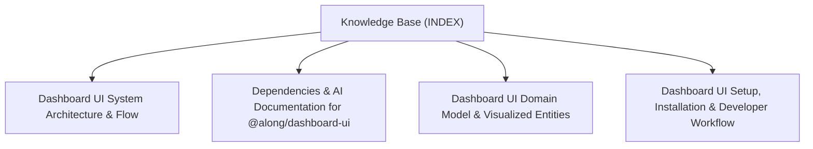

# Along Dashboard UI (`@along/dashboard-ui`) - Knowledge Base Topic Index

Central entry point and cross-linked topic catalog for project documentation:

## Knowledge Graph & Topic Map

---

## Articles

- **[Dashboard UI System Architecture & Flow](./topic--architecture.md)** (architecture) `architecture`, `boundaries`, `dynstruct`, `msgmesh`, `dashboard`, `ui-core`
- **[Dependencies & AI Documentation for @along/dashboard-ui](./topic--dependencies.md)** (topic) `dependencies`, `subproject`, `ai-context`, `rules`
- **[Dashboard UI Domain Model & Visualized Entities](./topic--domain-model.md)** (domain-model) `domain-model`, `entities`, `schemas`, `dag`, `metadata`
- **[Dashboard UI Setup, Installation & Developer Workflow](./topic--setup-and-workflow.md)** (setup-workflow) `setup`, `workflow`, `installation`, `lifecycle`, `quality-gates`

---

## Related Context

- [AGENTS.md](../AGENTS.md): Active protocol conventions and rules.
- [Domain Model & Entity Ecosystem](./topic--domain-model.md): Specifications for active issues and project history.
