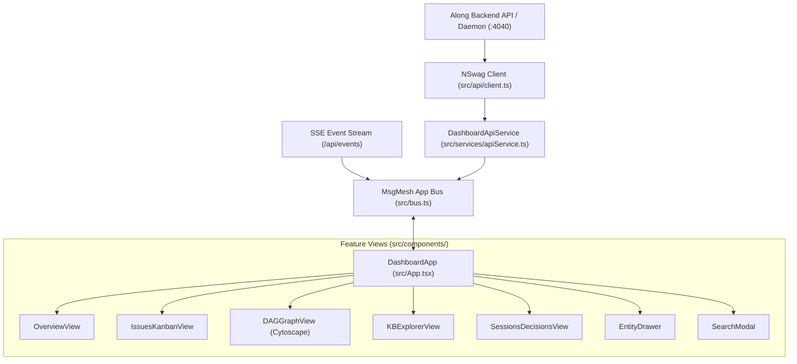

# Dashboard UI System Architecture & Flow

The Along Dashboard UI (`@along/dashboard-ui`) is the executive visualization web client for repository memory, entity graphs, and agent sessions. It is implemented with the Dynstruct component model, MsgMesh bus communication, and `@actdim/ui-core` styling foundations.

---

## Topology

The application topology connects the web client to the local Along daemon or static server:

---

## Core Components

1. **`DashboardApp` (`src/App.tsx`)**:
   Top-level shell coordinating top navigation header, tabs bar (`@actdim/dynstruct-mui/Tabs`), active view switcher, sliding `EntityDrawer`, and command palette `SearchModal`.
2. **`DashboardApiService` (`src/services/apiService.ts`)**:
   Encapsulates NSwag-generated HTTP client invocations and translates raw JSON responses into typed domain entities dispatched over the `c.msgBus`.
3. **`OverviewView` (`src/components/OverviewView.tsx`)**:
   Executive health summary cards, active milestones, recent sessions, and protocol alerts.
4. **`IssuesKanbanView` (`src/components/IssuesKanbanView.tsx`)**:
   Multi-column status board (`in-progress`, `open`, `done`, `blocked`) with fast text filtering and entity selection.
5. **`DAGGraphView` (`src/components/DAGGraphView.tsx`)**:
   Interactive topological dependency graph rendered with Cytoscape.js, depicting issue blockers, parents, and milestone targets.
6. **`KBExplorerView` (`src/components/KBExplorerView.tsx`)**:
   Knowledge Base documentation browser with split-pane markdown viewer sanitized via DOMPurify.
7. **`SessionsDecisionsView` (`src/components/SessionsDecisionsView.tsx`)**:
   Audit log of agent execution sessions and architectural decision records (ADRs).

---

## Data Flow

1. **Initial Bootstrap**:
   - `main.tsx` mounts `DashboardApp` inside `#root`.
   - `DashboardApp` action `loadData` invokes `API.DASHBOARD.GETFULLDATA` via `DashboardApiService`.
   - On completion, `APP.DATA.UPDATED` payload sets reactive model state `m.props.data`.
2. **Live Synchronization**:
   - A Server-Sent Events (SSE) listener receives incremental updates from the repository daemon.
   - Updates publish `APP.DATA.UPDATED` to refresh the active views without full page reloads.
3. **User Navigation & Selection**:
   - Tab changes dispatch `APP.TAB.SET` with the destination view key.
   - Clicking an entity card or graph node dispatches `APP.ENTITY.SELECT` with the canonical entity slug.
   - `EntityDrawer` observes `m.props.selectedEntityId` via two-way binding and slides in from the right.

---

## Invariants

1. **Dynstruct Component Boundary**:
   Every visual component is a Dynstruct struct. Raw React state hooks (`useState`, `useEffect`, `useMemo`) are prohibited in UI components; reactive properties belong exclusively to model `props`.
2. **Strict Prop-less JSX**:
   Child components declared in `def.children` are rendered without inline props: `<c.children.Name />`.
3. **Bus-First Decoupling**:
   Feature views never pass callback props (`onSelect`, `onClose`) between components. Coordination is mediated by typed MsgMesh channels defined in `src/bus.ts`.
4. **Strict Typing**:
   Zero `any` or `as ...` casting allowed. All API responses conform to NSwag generated types.
5. **Markdown Sanitization & CSP**:
   All rendered markdown is sanitized with DOMPurify with strict HTML tag filtering.

---

## UI Core Integration & Application Delta

Following the `@actdim/ui-core` Theme Extension Policy (`@actdim/ui-core/docs/topic--developer-guide.md`):

1. **Foundational Token Governance**:
   All core palettes, typography scales, spacing units, and overlay primitives are governed exclusively by `@actdim/ui-core` via `@import "@actdim/ui-core/theme.css"` in `src/index.css`.
2. **Direct Library Imports (Zero-Bridge Architecture)**:
   Components import design utilities, overlay primitives, and layout hooks directly from `@actdim/ui-core/theme`, `@actdim/ui-core/components`, and `@actdim/ui-core/layout` without local wrapper shims or re-export bridges.
3. **Application Delta (Permitted Extensions)**:
   - **Third-Party Plugins**: `@plugin "@iconify/tailwind4"` in `src/index.css` for Lucide icon rendering.
   - **Scrollbar Styling**: Webkit custom scrollbars configured in `src/index.css`.
   - **Markdown Typography**: `.markdown-body` selector styles for rendered documentation.
