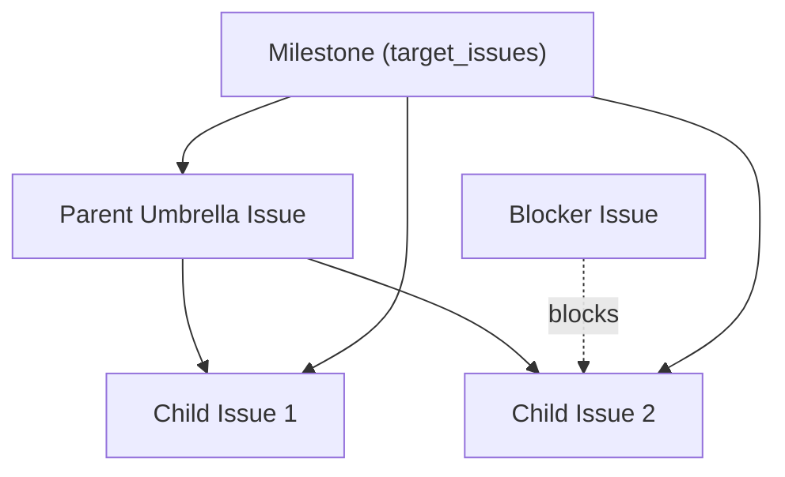

# Dashboard UI Domain Model & Visualized Entities

The Along Dashboard UI models and visualizes the provider-agnostic entity graph stored in `.along/`.

---

## Entity Taxonomy

The dashboard renders the following core Along entities:

1. **Issues (`feat`, `bug`, `debt`, `task`, `docs`, `spike`)**:
   Units of engineering work stored in `.along/ISSUES/<type>--<slug>.md`. Categorized into Kanban columns based on `status: open | in-progress | blocked | done`. A risk or blocker is an issue tagged `risk`.
2. **Decisions (ADRs)**:
   Architectural decision records stored in `.along/DECISIONS/ADR-YYYY-MM-DD--<slug>.md`. Tracked by status (`accepted`, `superseded`, `deprecated`).
3. **Milestones**:
   Sprint and release targets stored in `.along/MILESTONES/vX.Y.Z--<slug>.md`. Aggregates target issue completion ratios.
4. **Sessions**:
   Historical agent execution summaries stored in `.along/SESSIONS/<YYYY>/<date>--<slug>.md`.

---

## Front-Matter Schemas

Entities ingested by `DashboardApiService` share a common YAML front-matter envelope:

```yaml
---
protocol: along
protocol_version: "4.4.16"
slug: <kebab-slug>
title: "<Human Readable Title>"
type: feat | bug | debt | task | docs
status: open | in-progress | blocked | done
priority: high | medium | low
created: YYYY-MM-DD
updated: YYYY-MM-DD
agent: antigravity
tags: [tag1, tag2]
parent: <optional-parent-key>
blocked_by: [<dependency-key>]
related: [<related-key>]
---
```

### Visual Model Mapping
The dashboard maps entity front-matter into `FullDashboardData`:
- `id`: canonical key `<type>--<slug>`.
- `title`, `status`, `priority`: rendered in Kanban cards and header badges.
- `blocked_by`, `parent`: transformed into directed graph edges for Cytoscape.

---

## Graph Relationships

The DAG Graph view (`DAGGraphView.tsx`) visualizes dependency topologies:



1. **Parent-Child Hierarchy (`parent`)**: Solid arrows connecting subproject or child tasks to their enclosing umbrella issue.
2. **Blocking Dependencies (`blocked_by`)**: Dashed red arrows representing critical path bottlenecks preventing issue advancement.
3. **Milestone Targets (`target_issues`)**: Enclosing clusters grouping issues scheduled for a release.
